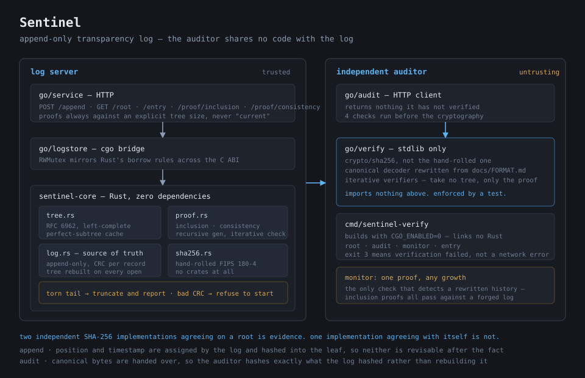

# 🛡️ Sentinel

*An append-only transparency log where the interesting claim is not that it stores records, but that it cannot quietly change one — and that you do not have to take its word for it.*



## 🔭 What It Is

A transparency log: a service you can append to, where historical entries cannot be altered without the alteration being externally detectable.

It maintains an authenticated Merkle-tree representation of its contents and issues two kinds of cryptographic proof. An **inclusion proof** shows that a particular record exists under a published root. A **consistency proof** shows that a newer version of the log is an append-only *extension* of an older one, rather than a rewritten history. That second one is the point — a log that quietly rewrote its past would still produce perfectly valid inclusion proofs against its own forged root, so inclusion alone proves nothing about integrity over time.

The persisted log is the source of truth and the tree is derived from it, rebuilt on every open. Entries are framed with a per-record checksum, so a crash mid-append is recoverable while a tampered record is a refusal to start — those two failures look alike and need opposite responses.

Verification lives outside the server. `go/verify` and `go/audit` share no code with the log: they re-implement the hashing with Go's standard library against the core's hand-written SHA-256, and the auditor binary builds with `CGO_ENABLED=0` so it links nothing from the thing it audits. An auditor that has to run the log's own code to check the log has not checked anything.

```
$ sentinel-verify audit -server http://127.0.0.1:8080
verified 25 entries and 12 consistency proofs against root 6b7893d3… (size 25) in 23ms

$ sentinel-verify monitor -size 0 -root e3b0c442…
the log at size 25 is an append-only extension of size 0
```

## ✨ Inspo

I could describe a Merkle tree before I wrote this. I could not have told you why the root of an empty tree is `SHA-256("")` rather than thirty-two zero bytes — and the answer turns out to be the difference between a verifier that works and one that accepts any history an attacker likes.

The gap I wanted to close was between *authenticated data structure* as a phrase and as a thing with edges. Most of the work turned out not to be the tree at all. It was the places where two implementations have to agree exactly: byte-level serialization, odd tree sizes, what counts as a recoverable crash. Those are invisible until you build the second implementation and watch it disagree with the first.

The reading behind it: [RFC 6962](https://www.rfc-editor.org/rfc/rfc6962) for Certificate Transparency's tree and proof algorithms, [RFC 9162](https://www.rfc-editor.org/rfc/rfc9162) for the iterative verification forms, and Crosby & Wallach's [*Efficient Data Structures for Tamper-Evident Logging*](https://www.usenix.org/legacy/event/sec09/tech/full_papers/crosby.pdf) for the history-tree framing.

## 🛠️ Tech Stack

**Rust** for the core — the append-only log, the Merkle tree, proof generation and verification, and the C ABI.

- No dependencies. `Cargo.toml` has no `[dependencies]` section at all: SHA-256, CRC-32C, the tree, the proofs and the storage framing are the project, so importing them would leave nothing behind.
- `overflow-checks = true` in release builds, because a wrapped position or tree size would produce a valid-looking proof for the wrong entry.
- Hand-written SHA-256 (FIPS 180-4), which exists so the Go verifier's `crypto/sha256` is a genuinely independent cross-check rather than the same code twice.

**Go** for the service and the auditor.

- Standard library only; `go.mod` has no `require` block.
- `cgo` over a hand-written C header, `staticlib` crate type.
- The verifier and auditor packages import nothing but stdlib, enforced by a test that parses their own imports.

**Build and verify**

```bash
cd sentinel-core && cargo test && cargo clippy --all-targets
cd ../go && go test -race ./...
cd .. && ./scripts/demo.sh        # serve, audit, tamper, watch it refuse
```

71 Rust tests and 61 Go tests, clean under `clippy` and `-race`.

## 📄 License

MIT. See [LICENSE](LICENSE).
